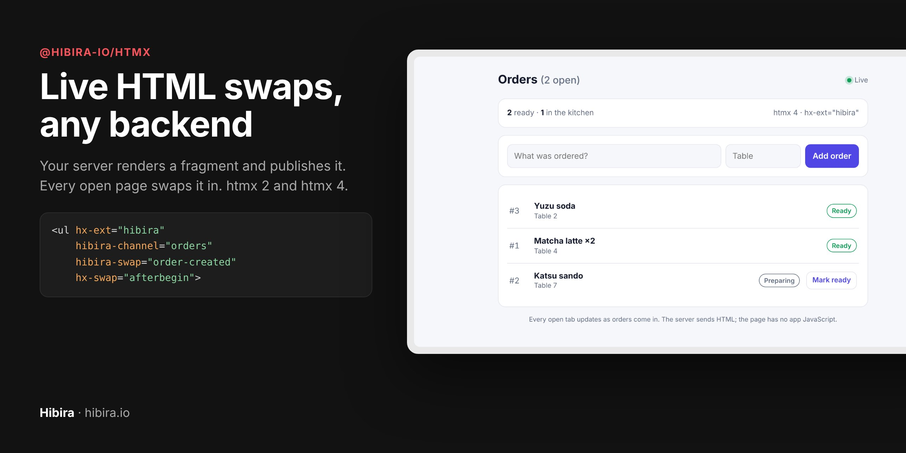
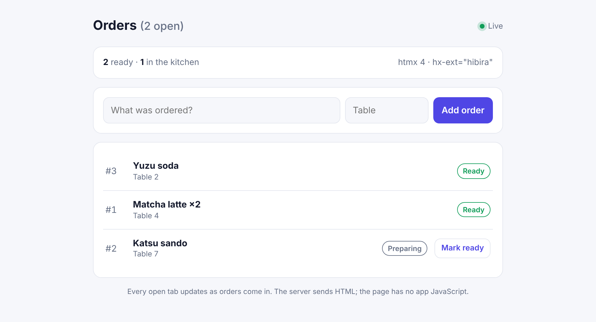
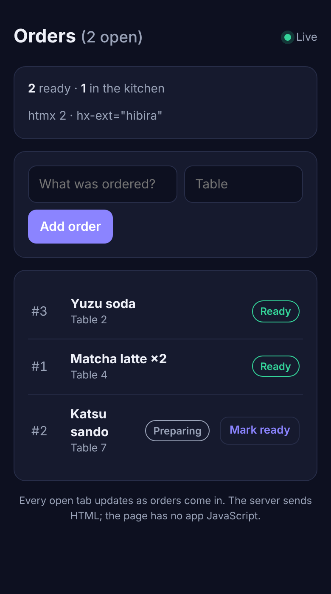

<p align="center"></p>

# @hibira-io/htmx

An htmx extension, `hx-ext="hibira"`, that swaps server-rendered HTML into
the page as it happens. Your backend renders a fragment and publishes it on
a [Hibira](https://hibira.io) channel (or any Pusher-compatible service).
Every open page swaps it in with the `hx-swap`, `hx-target` and out-of-band
rules you already know. Or the event just triggers the element's own
`hx-get`, and the page fetches fresh HTML from you.

- **Any backend.** Laravel, Django, Flask, FastAPI, Rails, Go, Express,
  anything with a Pusher server library.
- **htmx 2 and htmx 4**, from one file. About 2.5 KB gzipped.
- **No WebSocket server to run.** No Channels/ASGI, no Redis, no sticky
  sessions. Your app stays plain request/response.
- **Private channels** authorize against your backend, with the CSRF header
  your page already sends in `hx-headers`.
- **Shared subscriptions**: one per channel however many elements listen,
  dropped when the last one leaves the page.
- **Safe by default**: events browsers can send themselves (`client-*`)
  never swap HTML.

| Desktop (htmx 4) | Phone, dark (htmx 2) |
| --- | --- |
|  |  |

## Install

From a CDN, after htmx and pusher-js:

```html
<script src="https://cdn.jsdelivr.net/npm/htmx.org@2.0.11/dist/htmx.min.js"></script>
<script src="https://cdn.jsdelivr.net/npm/pusher-js@8.6.0/dist/web/pusher.min.js"></script>
<script src="https://cdn.jsdelivr.net/npm/@hibira-io/htmx@0.1.0/dist/hibira.min.js"></script>
```

Or from npm, with a bundler:

```sh
npm install @hibira-io/htmx htmx.org pusher-js
```

```js
import htmx from 'htmx.org';
import Pusher from 'pusher-js';
import { register } from '@hibira-io/htmx';

window.htmx = htmx;
register(htmx, { Pusher });
```

## Quick start

```html
<body hx-ext="hibira" hibira-connect="YOUR_APP_KEY">
  <ul id="orders"
      hibira-channel="orders"
      hibira-swap="order-created"
      hx-swap="afterbegin">
    …
  </ul>
</body>
```

Publish HTML from your server, and every page that shows `#orders` gets the
new row at the top:

```php
// Laravel, with the Pusher driver pointed at Hibira
broadcast(new OrderCreated($order)); // see "Server examples" below
```

```python
# Python: pip install pusher
hibira.trigger("orders", "order-created", render_to_string("orders/_row.html", {"order": order}))
```

```js
// Node: npm install pusher
await hibira.trigger('orders', 'order-created', `<li>#${order.id} ${escape(order.item)}</li>`);
```

`hx-ext="hibira"` is what htmx 2 needs. htmx 4 registers extensions for the
whole page, so there you can leave it out (it does no harm).

## Two ways to update the page

**Push the HTML** with `hibira-swap="event"`. The message is the HTML, and
the element swaps it like a response:

```html
<ul hibira-channel="orders" hibira-swap="order-created, order-updated" hx-swap="beforeend">
```

`hx-swap`, `hx-target`, `hx-select` and `hx-select-oob` all apply, and
out-of-band elements in the message (`<span id="count" hx-swap-oob="true">`)
update the rest of the page in the same swap. Messages swap in the order
they arrive.

**Push a nudge** with `hx-trigger="hibira:event"`. The element runs its own
request, so the HTML comes from your server over HTTP with the user's
session, at any size:

```html
<div id="cart" hibira-channel="private-cart.42"
     hx-get="/cart" hx-trigger="load, hibira:cart-changed">
```

Pick the nudge when the HTML depends on who is looking, or is bigger than
your plan's message size (4 KB on Free). In htmx 2 the event data is
available to `hx-vals='js:{id: event.detail.data.id}'`.

## Attributes

| Attribute | On | What it does |
| --- | --- | --- |
| `hibira-connect="KEY"` | an ancestor, usually `<body>` | Opens one connection with your app key. Removed from the page, it disconnects. |
| `hibira-channel="name"` | the element or an ancestor | Channel to listen on. `private-…` and `presence-…` channels are authorized by your backend. |
| `hibira-swap="a, b"` | the element | Swap the HTML in these events into the element. |
| `hx-trigger="hibira:event"` | the element | Fire the element's request when this event arrives. Mixes with other triggers. |
| `hibira-auth-endpoint="/path"` | the connect element | Where private channels are authorized. pusher-js defaults to `/pusher/auth`; Laravel uses `/broadcasting/auth`. |
| `hibira-options='{…}'` | the connect element | pusher-js options as JSON, merged over the Hibira defaults (`wsHost: "ws.hibira.io"`, TLS on). |

Every attribute also works with a `data-` prefix (`data-hibira-swap`).

The connect element gets `hibira-state="connecting|connected|unavailable|…"`,
so CSS can show a live dot or an offline banner:

```css
body:not([hibira-state="connected"]) .live-dot { opacity: .3; }
```

## Message format

| Published data | Result |
| --- | --- |
| a string | Swapped as HTML. |
| `{ "html": "…" }` (or `content`) | Swapped as HTML. Add `target`, `swap` or `select` to override the element's own for this message. |
| any other JSON | No swap. Read it in `hibira:before-swap`, or use `hx-trigger`. |

The server choosing the target is handy for updates to one row:

```js
await hibira.trigger('orders', 'order-updated', {
  html: renderRow(order),
  target: `#order-${order.id}`,
  swap: 'outerHTML',
});
```

## Private channels and CSRF

pusher-js asks your backend to sign each private or presence subscription.
The extension sends the headers from `hx-headers` on the connect element and
its ancestors with that request, so the CSRF token most htmx apps already
put on `<body>` just works:

```html
<!-- Laravel -->
<body hx-ext="hibira" hibira-connect="{{ config('broadcasting.connections.pusher.key') }}"
      hibira-auth-endpoint="/broadcasting/auth"
      hx-headers='{"X-CSRF-TOKEN": "{{ csrf_token() }}"}'>

<!-- Django -->
<body hx-ext="hibira" hibira-connect="{{ HIBIRA_KEY }}"
      hibira-auth-endpoint="/hibira/auth"
      hx-headers='{"X-CSRFToken": "{{ csrf_token }}"}'>
```

Already using Laravel Echo with the Pusher driver? Leave out
`hibira-connect`: the extension uses `window.Echo`'s connection, so the page
keeps one socket.

## Server examples

The app ID and key are on the app's page in the Hibira portal. The secret
is shown once, when you create the app: keep it in your backend's
environment, never in the page.

### Laravel

Set `BROADCAST_CONNECTION=pusher` and point the Pusher connection at
`ws.hibira.io` (or use [hibira-io/laravel](https://github.com/hibira-io/laravel)).
Name the event with `broadcastAs()` so the attribute stays short:

```php
class OrderCreated implements ShouldBroadcastNow
{
    public function __construct(public Order $order) {}

    public function broadcastOn(): Channel
    {
        return new Channel('orders');
    }

    public function broadcastAs(): string
    {
        return 'order-created';
    }

    public function broadcastWith(): array
    {
        return ['html' => view('orders._row', ['order' => $this->order])->render()];
    }
}
```

`new PrivateChannel('kitchen')` is `hibira-channel="private-kitchen"` on the page.

### Django, Flask, FastAPI

```python
import pusher

hibira = pusher.Pusher(
    app_id=os.environ["HIBIRA_APP_ID"],
    key=os.environ["HIBIRA_KEY"],
    secret=os.environ["HIBIRA_SECRET"],
    host="ws.hibira.io",  # the host shown on your app page
    ssl=True,
)

# after saving the order
hibira.trigger("orders", "order-created", render_to_string("orders/_row.html", {"order": order}))

# Django: the auth view for private channels
@login_required
@require_POST
def hibira_auth(request):
    channel = request.POST["channel_name"]
    if not may_join(request.user, channel):
        return HttpResponseForbidden()
    return JsonResponse(hibira.authenticate(channel=channel, socket_id=request.POST["socket_id"]))
```

### Rails

```ruby
# Gemfile: gem "pusher"
Hibira = Pusher::Client.new(
  app_id: ENV["HIBIRA_APP_ID"], key: ENV["HIBIRA_KEY"], secret: ENV["HIBIRA_SECRET"],
  host: "ws.hibira.io", use_tls: true,
)
Hibira.trigger("orders", "order-created", render_to_string(partial: "orders/row", locals: { order: }))
```

Using Turbo instead of htmx? See [hibira-io/rails](https://github.com/hibira-io/rails).

### Go

```go
client := pusher.Client{AppID: id, Key: key, Secret: secret, Host: "ws.hibira.io", Secure: true}
var buf bytes.Buffer
rowTemplate.Execute(&buf, order)
client.Trigger("orders", "order-created", buf.String())
```

## Events

| Event | Fired on | `detail` |
| --- | --- | --- |
| `hibira:before-swap` | the swapping element | `{ channel, event, data, message }`. Cancel to skip the swap, or edit `message.html`. |
| `hibira:after-swap` | the swapping element | Same as above. |
| `hibira:<event>` | elements with `hx-trigger="hibira:<event>"` | `{ channel, event, data }` |
| `hibira:state` | the connect element | `{ state }` |
| `hibira:error` | the element | `{ error }`. Cancel it to stop the console warning. |

```js
// Skip messages this tab sent itself; it already showed them.
document.querySelector('#chat').addEventListener('hibira:before-swap', (event) => {
  if (event.detail.data?.from === myTabId) event.preventDefault();
});
```

## JavaScript API

The npm module exports these; the script-tag build puts them on
`window.HibiraHtmx`.

- `register(htmx, { Pusher, client, options })` registers the extension.
  The script-tag build calls it for you.
- `configure({ Pusher, client, options })` changes settings later. `client`
  is a pusher-js client to use where no ancestor has `hibira-connect`.
- `clientFor(element)` returns the pusher-js client an element uses, for
  presence or client events you want to handle in JavaScript.

## Security notes

- Only your server, holding the app secret, can publish to a channel.
  Browsers can send `client-*` events on private channels when client events
  are on for the app, so `hibira-swap` refuses those names. Use them with
  `hx-trigger` (which fetches from your server) or your own listener.
- HTML you publish is inserted as is, like any htmx response. Escape user
  input when you render it, as you already do for your pages.
- On the Free plan, add your site's origin (for example
  `http://localhost:8000`) to the app's allowed origins, or browsers can't
  connect.

## Development

```sh
npm install
npm test            # builds dist/, then runs htmx 2 and htmx 4 in jsdom
npm run typecheck
```

`npm run test:e2e` drives two Chromium tabs through the order board in
`test/e2e/app.mjs` against a real server, with both htmx versions. It needs
Playwright and a Hibira app (or a local Pusher-compatible server):

```sh
HIBIRA_E2E_HOST=127.0.0.1 HIBIRA_E2E_PORT=6001 HIBIRA_E2E_TLS=0 \
HIBIRA_E2E_APP_ID=… HIBIRA_E2E_KEY=… HIBIRA_E2E_SECRET=… npm run test:e2e
```

`node test/e2e/app.mjs` with the same variables serves the board on
http://127.0.0.1:3000 (`?htmx=4`, `&theme=dark`).

## 中文摘要

`@hibira-io/htmx` 是 htmx 擴充 `hx-ext="hibira"`：後端把渲染好的 HTML 片段發到
Hibira 頻道，所有開著的頁面就依照 `hx-swap`、`hx-target` 與 out-of-band 規則即時換上；
也可以用 `hx-trigger="hibira:事件"` 只通知頁面，讓元素自己用 `hx-get` 跟你的後端拿新 HTML
（適合依使用者而不同或超過 4 KB 的內容）。支援 htmx 2 與 htmx 4，任何有 Pusher 伺服器函式庫的後端
（Laravel、Django、Flask、Rails、Go、Node）都能用，不必自架 WebSocket 伺服器或 Redis。
私人頻道會帶上 `hx-headers` 裡的 CSRF 標頭向你的後端授權；瀏覽器可自行送出的 `client-*` 事件不會被換成 HTML。

## License

MIT
